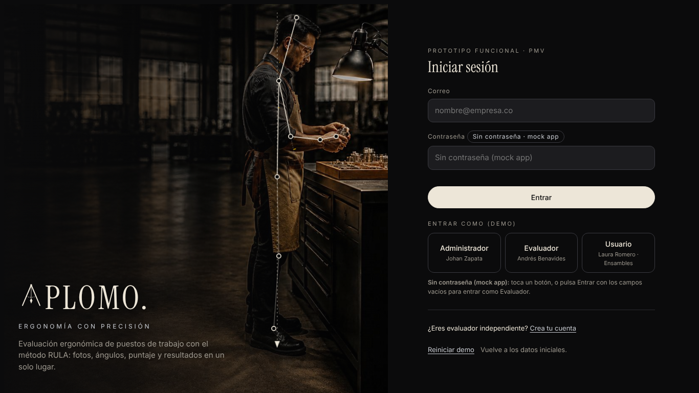
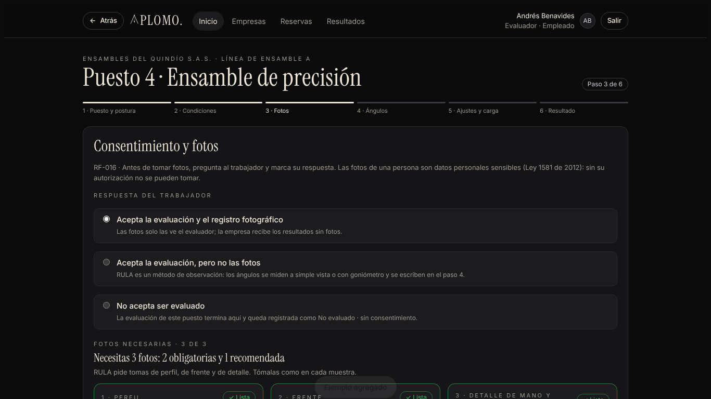
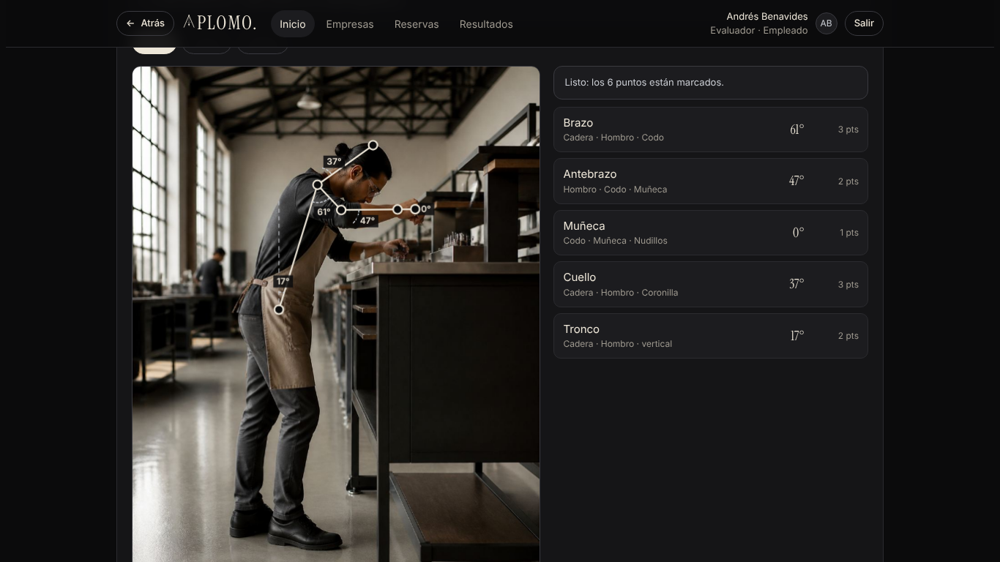
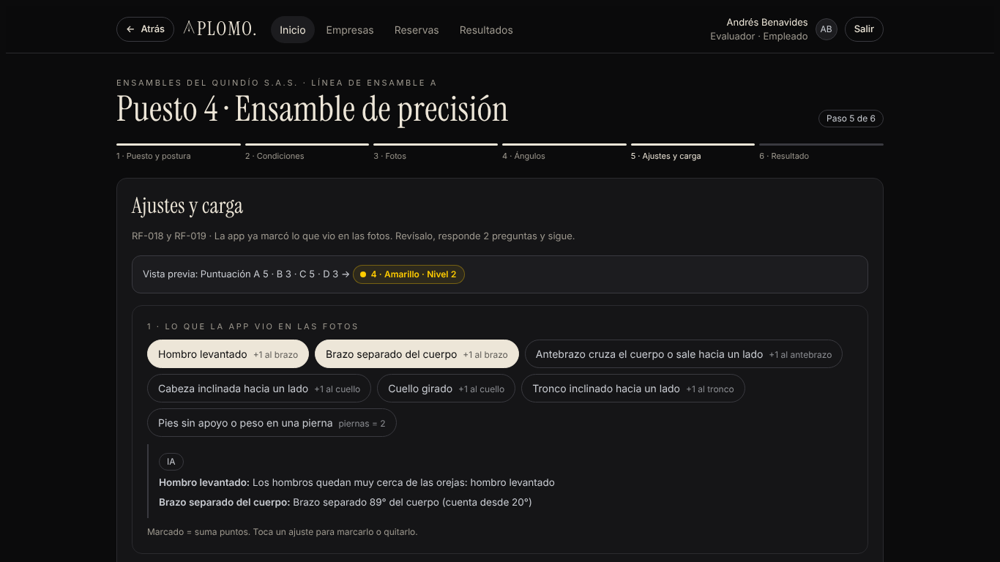
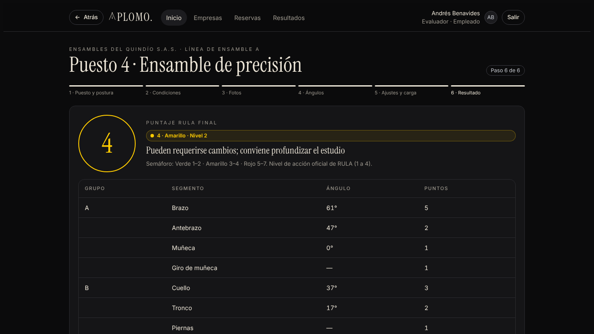
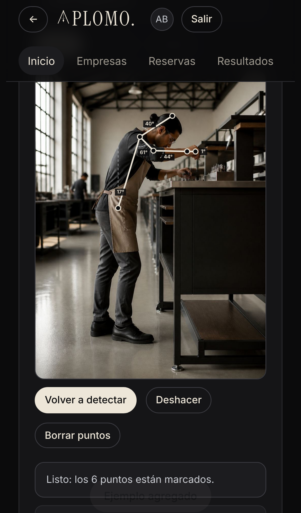
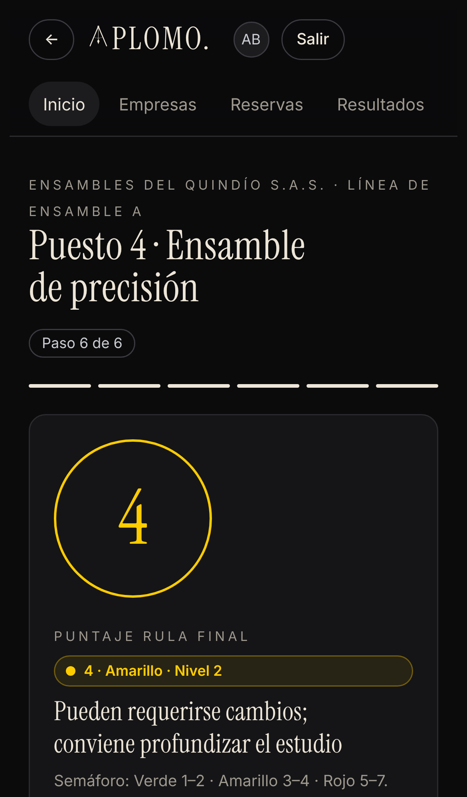

<div align="center">

# APLOMO.

**Ergonomía con precisión**

Evaluación ergonómica de puestos de trabajo con el método RULA:<br>
fotos guiadas, puntos del cuerpo detectados con IA, ángulos, puntaje y resultados en un solo lugar.

[**Abrir la app**](#cómo-abrirla) · [Funciones](#funciones) · [Cómo funciona](#cómo-funciona-el-método-rula) · [Historial](CHANGELOG.md)



</div>

---

## Qué es

APLOMO es el **prototipo funcional (PMV)** de una aplicación para ingenieros industriales que evalúan la postura de los trabajadores en su puesto. El evaluador visita la empresa, toma las fotos, la app mide los ángulos del cuerpo y calcula el puntaje RULA con su semáforo de riesgo. La empresa ve los resultados y descarga la ficha en PDF.

Es un prototipo: funciona completo en el navegador, con datos de demostración y sin servidor ni base de datos.

## Funciones

| | |
|---|---|
| **Roles** | Administrador, Evaluador (empleado o independiente) y Usuario de la empresa, cada uno con su menú. |
| **Empresas y sedes** | Clientes, sedes, áreas y puestos de trabajo. |
| **Reservas y visitas** | El usuario pide la visita, el evaluador la acepta y la realiza. |
| **Fotos guiadas** | Tres tomas por puesto (perfil, frente y detalle), cada una con su diagrama de cámara y una foto de ejemplo. Opción de evaluar el otro lado del cuerpo. |
| **Puntos con IA** | La IA (MediaPipe Pose) encuentra los 6 puntos del cuerpo en la foto. El evaluador los revisa y los arrastra con el mouse o con el dedo. |
| **Ajustes sugeridos** | La foto de frente sugiere los ajustes de RULA (hombro elevado, cuello girado, brazo separado, etc.). |
| **Puntaje RULA** | Tablas A, B y C oficiales, nivel de acción 1 a 4 y semáforo verde, amarillo y rojo. |
| **Resultados y PDF** | Resultados por empresa y por puesto, con ficha descargable en PDF. |
| **Funciona en todo** | Computador, iPad y celular. |

## Capturas

<table>
<tr>
<td width="50%"><br><sub><b>Fotos guiadas:</b> las 3 tomas con su ejemplo.</sub></td>
<td width="50%"><br><sub><b>Ángulos:</b> puntos detectados con IA.</sub></td>
</tr>
<tr>
<td><br><sub><b>Ajustes y carga:</b> sugeridos desde la foto de frente.</sub></td>
<td><br><sub><b>Resultado:</b> puntaje final, nivel y semáforo.</sub></td>
</tr>
</table>

<p align="center">

&nbsp;&nbsp;

</p>

## Cómo abrirla

- **En línea:** el enlace de GitHub Pages que aparece en la parte derecha de este repositorio ("About").
- **Sin instalar nada:** descarga `index.html` y ábrelo en Chrome, Safari o Edge. La detección con IA y el PDF necesitan internet.

Para entrar, toca uno de los roles en "Entrar como (demo)". No hay contraseñas. "Reiniciar demo" vuelve a los datos iniciales.

## Cómo funciona el método RULA

RULA (*Rapid Upper Limb Assessment*) evalúa la carga postural de los miembros superiores:

1. **Grupo A:** brazo, antebrazo, muñeca y giro de muñeca.
2. **Grupo B:** cuello, tronco y piernas.
3. Se suman la actividad muscular y la carga o fuerza.
4. La tabla C da el **puntaje final de 1 a 7** y el **nivel de acción**:

| Puntaje | Nivel | Semáforo | Qué hacer |
|---|---|---|---|
| 1 a 2 | 1 | 🟢 Verde | Postura aceptable. |
| 3 a 4 | 2 | 🟡 Amarillo | Pueden requerirse cambios. |
| 5 a 6 | 3 | 🔴 Rojo | Se requieren cambios pronto. |
| 7 | 4 | 🔴 Rojo | Se requieren cambios ya. |

Referencia: [Ergonautas, Universidad Politécnica de Valencia](https://www.ergonautas.upv.es/metodos/rula/rula-ayuda.php).

## Tecnología

- HTML, CSS y JavaScript sin frameworks, en un solo archivo.
- [MediaPipe Pose](https://developers.google.com/mediapipe) para detectar los puntos del cuerpo.
- [jsPDF](https://github.com/parallax/jsPDF) y [html2canvas](https://html2canvas.hertzen.com/) para la ficha en PDF.
- Tipografías Instrument Serif e Inter. Estética "Obsidian & Ivory" (modo oscuro).

## Estructura

```
index.html                  la app lista para usar (generada)
src/app.src.html            código fuente de la app
src/img/                    fotos de demostración
build.py                    genera index.html con las fotos incluidas
docs/capturas/              capturas de pantalla
versiones/                  copias congeladas de versiones anteriores
CHANGELOG.md                historial de versiones
```

Para cambiar la app: edita `src/app.src.html` y ejecuta `python3 build.py`.

## Equipo

Proyecto Nuclear · Ingeniería de Requisitos · Corporación Universitaria Empresarial Alexander von Humboldt · 2026

- Laura Gabriella Romero Gómez
- Johan Andrés Zapata Quintero
- Andrés Eduardo Benavides

Las fotos de demostración fueron generadas con IA; las personas que aparecen no existen. Los datos de empresas son de demostración.

## Licencia

[MIT](LICENSE)
